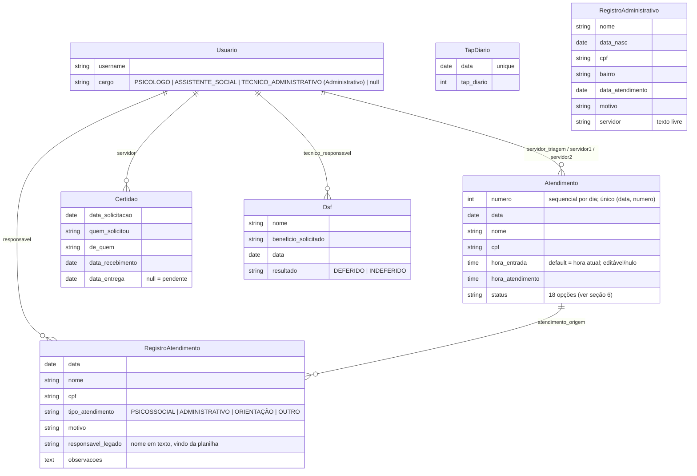
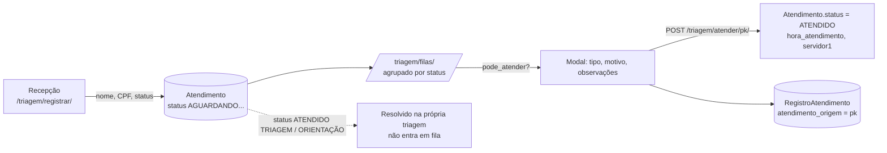

# Mapa do Projeto — Gestão CRAS (Django)

> Levantamento feito em **17/11/2026** a partir da leitura de todo o código, do `manage.py check` e do banco `db.sqlite3` local.
> Serve como referência rápida do que existe hoje, como as peças se ligam e o que precisa de atenção.
> **Atualizado no mesmo dia:** os bugs A1–A7 e dois bugs do importador foram corrigidos. Ver a seção 10.

---

## 1. O que é

Sistema web que **substitui a planilha `PROJETO BANCO DE DADOS - CRAS.xlsx`** usada no CRAS. Cada aba da planilha virou um app Django.

O núcleo é o fluxo **triagem → fila → atendimento**:

- a recepção registra quem chegou;
- a pessoa entra na fila do seu status (prioridade / psicossocial);
- o servidor com o cargo certo clica em *Atender agora*, e o sistema grava o atendimento.

| Aba da planilha | App Django | Modelo | Situação |
|---|---|---|---|
| CONTROLE DE ATENDIMENTOS DIÁRIO | `triagem` | `Atendimento` | Operacional (registrar, filas, atender, controle) |
| REGISTRO DE ATENDIMENTOS | `atendimentos` | `RegistroAtendimento` | Só listagem; criado automaticamente ao atender |
| CERTIDÕES | `certidoes` | `Certidao` | Lista, cria e edita |
| DSF CONCLUÍDO | `dsf` | `Dsf` | Lista e cria (sem edição) |
| 2026 TAP MENSAL | `tap` | `TapDiario` | Grade mensal editável |
| 1S2024 ATENDIMENTO ADMINISTRATI | `administrativo` | `RegistroAdministrativo` | Histórico só leitura, com busca e paginação |
| *(nova)* | `usuarios` | `Usuario` | Usuário customizado com `cargo` |

---

## 2. Stack e como rodar

| Item | Valor |
|---|---|
| Python | 3.12.3 |
| Django | 5.2.8 |
| openpyxl | 3.1.5 (só para importar a planilha) |
| Banco | SQLite (`db.sqlite3`) |
| Front | Templates Django + CSS próprio ([cras/static/cras/css/tema.css](cras/static/cras/css/tema.css)), Google Fonts (Inter, Plus Jakarta Sans, Material Symbols). Sem framework JS; só o **Apache ECharts 6.1.0** no Painel, servido localmente de `cras/static/cras/js/echarts.min.js` (funciona sem internet). |
| Idioma / fuso | `pt-br` / `America/Sao_Paulo`, `USE_TZ=True` |

```bash
python manage.py migrate
python manage.py createsuperuser
python manage.py importar_planilha          # ATENÇÃO: já foi rodado, veja a seção 9
python manage.py runserver

python manage.py demo_triagens              # enche o app de triagens fictícias (apaga a demo anterior)
python manage.py demo_triagens --remover    # apaga só a demonstração
```

O `demo_triagens` cria:
- 7 servidores fictícios `demo_*`, sem senha;
- cerca de 950 triagens dos últimos 30 dias úteis, sem feriados nacionais;
- os registros de atendimento de quem foi atendido;
- 28 pessoas aguardando hoje.

Tudo fica ligado aos usuários `demo_*`, e é por eles que o `--remover` encontra o que apagar, sem tocar nos dados reais. A espera de hoje é contada a partir da hora em que o comando roda, então rode de novo em outro dia para "hoje" continuar cheio.

> Não existe `requirements.txt`. As dependências estão só no ambiente global do Python.

---

## 3. Estrutura de pastas

```
Gestao Cras Django/
├── manage.py
├── db.sqlite3                         # banco local (já contém dados reais importados)
├── PROJETO BANCO DE DADOS - CRAS.xlsx # planilha original (dados pessoais: nome, CPF, telefone)
├── summary.json                       # amostra/estrutura das abas da planilha (gerado para análise)
├── cras/                              # projeto: settings, urls, painel inicial, CSS, templatetags
│   ├── settings.py
│   ├── urls.py
│   ├── views.py                       # view "inicio" (Painel)
│   ├── templatetags/cras_extras.py    # filtros get_item, split, startswith, status_classe
│   └── static/cras/css/tema.css
├── usuarios/                          # Usuario(AbstractUser) + cargo
├── triagem/                           # Atendimento, filas, regras de prioridade/permissão
│   └── management/commands/importar_planilha.py
├── atendimentos/                      # RegistroAtendimento
├── certidoes/                         # Certidao
├── dsf/                               # Dsf
├── tap/                               # TapDiario
├── administrativo/                    # RegistroAdministrativo (histórico 1S2024)
├── templates/                         # todos os templates (base.html + 1 pasta por app)
└── stitch_sistema_de_atendimento_cras/
    ├── DESIGN.md                      # design system "Assistência Social Integrada"
    ├── code.html                      # mockup estático (Tailwind CDN) que inspirou o layout
    └── screen.png
```

---

## 4. Modelos de dados



Pontos importantes:

- **Todos os FKs para `Usuario` usam `SET_NULL`**: apagar um servidor não apaga histórico.
- **Não existe entidade "Cidadão/Pessoa".** Nome e CPF são repetidos em `Atendimento`, `RegistroAtendimento` e `RegistroAdministrativo`, sem ligação entre eles. Também não há validação nem normalização de CPF.
- `TapDiario` e `RegistroAdministrativo` não têm nenhum vínculo com usuário.
- `servidor2` nunca é preenchido por nenhuma tela, só pelo `/admin/`.

---

## 5. Rotas

Todas as views usam `@login_required`. Fora a regra de fila (seção 6), **qualquer usuário logado acessa e edita tudo**.

| URL | View | Template | O que faz |
|---|---|---|---|
| `/` | `cras.views.inicio` | `inicio.html` | Painel do dia: total, aguardando, atendidos, espera média e as duas filas (administrativa e psicossocial) com os 5 próximos a chamar; abaixo, os gráficos (seção 8.1) |
| `/login/`, `/logout/` | `LoginView` / `LogoutView` | `registration/login.html` | Autenticação (logout via POST) |
| `/admin/` | Django admin | — | Edição bruta de tudo |
| `/usuarios/`, `nova/`, `<pk>/editar/`, `<pk>/senha/`, `<pk>/ativar/` | `usuarios.*` | `usuarios/lista.html`, `form.html`, `senha.html` | Contas de usuário, só para administrador (seção 6.4) |
| `/triagem/registrar/` | `triagem.registrar` | `triagem/registrar.html` | Registra chegada: nome, CPF, **tipo de fila** (administrativa/psicossocial), **prioridade** e "resolvido na triagem" |
| `/triagem/filas/` | `triagem.filas` | `triagem/filas.html` + `_modal_atender` | Duas listas em linhas (Administrativo e Psicossocial) já na ordem de chamada, com o botão *Atender* |
| `/triagem/atender/<pk>/` | `triagem.atender` | — (POST) | Marca como ATENDIDO e cria `RegistroAtendimento` |
| `/triagem/controle/?data=` | `triagem.controle` | `triagem/controle.html` | Tabela do dia (equivale à aba CONTROLE DIÁRIO) |
| `/atendimentos/?data=` | `atendimentos.lista` | `atendimentos/lista.html` | Lista de registros de atendimento |
| `/certidoes/`, `nova/`, `<pk>/editar/` | `certidoes.*` | `certidoes/lista.html`, `form.html` | CRUD sem exclusão; conta pendentes (sem `data_entrega`) |
| `/dsf/`, `novo/` | `dsf.*` | `dsf/lista.html`, `form.html` | Lista com contagem de deferidos/indeferidos e cadastro |
| `/tap/?ano=&mes=` | `tap.mensal` | `tap/mensal.html` | Grade de 28–31 campos; salva todos os dias do mês |
| `/administrativo/?q=` | `administrativo.lista` | `administrativo/lista.html` | Busca por nome/CPF/motivo, 50 por página |

---

## 6. Regras de negócio (triagem)

Fonte: [triagem/models.py](triagem/models.py)

### 6.1 Fluxo



O sistema grava sozinho:

- **ao registrar:** `numero` (sequencial do dia), `data`, `hora_entrada` e `servidor_triagem`;
- **ao atender:** `hora_atendimento`, `servidor1`, status `ATENDIDO` e um `RegistroAtendimento`.

### 6.2 Status e filas

17 status ao todo. **15 viram fila** (`FILAS`) e 2 são finais (`ATENDIDO` e `ATENDIDO TRIAGEM / ORIENTAÇÃO`). O status `AGENDAMENTO ONLINE` foi removido em 23/11/2026 (migração `triagem/0004`), porque o atendimento do CRAS é só presencial. Nenhum registro real usava esse status.

| Grupo | Status | Cor (`tone`) |
|---|---|---|
| Geral | AGUARDANDO ATENDIMENTO | teal |
| Prioridade | 60+, 80+, PCD, AUTISTA, GESTANTE / CRIANÇA DE COLO | âmbar |
| Psicossocial (cada prioridade tem versão psicossocial) | AGUARDANDO ATENDIMENTO PSICOSSOCIAL [+ 60+/80+/PCD/AUTISTA/GESTANTE], LIBRAS PSICOSSOCIAL | azul |
| Outros | LIBRAS, REUNIÃO | cinza |

Detalhes da implementação:

- **Triagem (desde 23/11/2026):** a tela pergunta o **tipo de fila** (Atendimento administrativo ou psicossocial) e a **prioridade** (sem prioridade, 60+, 80+, PcD, Autista, Gestante ou criança de colo, Libras). O banco continua guardando o status combinado, no vocabulário da planilha, via `STATUS_DA_FILA` em [triagem/models.py](triagem/models.py). Exemplo: psicossocial + 60+ = `AGUARDANDO ATENDIMENTO PSICOSSOCIAL 60+`.
  - A caixa *Resolvido na própria triagem* grava `ATENDIDO TRIAGEM / ORIENTAÇÃO`, sem entrar na fila.
  - `REUNIÃO` não é mais oferecido na triagem; continua no modelo só para registros antigos.
- **Motivos do atendimento:** no *Atender*, os motivos são de múltipla escolha. Ficam em `RegistroAtendimento.motivo`, separados por `; ` e na ordem de `MOTIVOS`, e a propriedade `.motivos` devolve a lista.
- **Ordem de chamada (tela Filas):** `listas_de_chamada()` em [triagem/models.py](triagem/models.py) separa quem aguarda em duas listas, **Administrativo** e **Psicossocial**, e ordena cada uma por:
  1. **80+**;
  2. **demais prioritários** (60+, PcD, Autista, Gestante / criança de colo, Libras);
  3. **todos os outros** (geral, Reunião).

  Dentro de cada grupo vale a ordem de chegada (senha). Regra definida pelo usuário em 17/11/2026.
- **Painel:** mostra as mesmas duas filas (`listas_de_chamada()`), com os 5 próximos a chamar em cada uma. Até 23/11/2026 havia um card por status; `filas_do_dia()` foi removida.
- **DSF:** *Benefício solicitado* é uma lista de seleção (`Dsf.Beneficio`): Cesta Básica, Fralda ou Absorvente.
- **Atendimento:** `atender` faz um `UPDATE ... WHERE status = <status lido>` dentro de `transaction.atomic`. Se outro servidor já tirou a pessoa da fila, o UPDATE não afeta nenhuma linha e nada é gravado.
- **Número da senha:** a constraint `triagem_numero_unico_por_dia` garante que o número não se repete no dia. Em caso de colisão, o `save()` tenta o próximo número livre (até 5 vezes).

### 6.3 Quem pode atender (`pode_atender`)

Só quem está com status de fila pode ser atendido. Pessoas já `ATENDIDO` ou `ATENDIDO TRIAGEM / ORIENTAÇÃO` são recusadas para qualquer usuário, inclusive superusuário.

| Usuário | Filas psicossociais | Demais filas |
|---|---|---|
| Administrador do sistema (superusuário) | ✅ | ✅ |
| Psicólogo(a), Assistente Social | ✅ | ✅ |
| Administrativo | ❌ | ✅ |
| Sem cargo | ❌ | ❌ |

### 6.4 Contas de usuário (`/usuarios/`, desde 23/11/2026)

Só o **administrador do sistema** (superusuário) vê o menu *Administração → Usuários*. Quem não é administrador e abre a URL volta para o Painel com aviso.

- **Cargos:** são três, *Assistente Social*, *Psicólogo(a)* e *Administrativo*. O cargo *Coordenador(a)* foi removido (nenhuma conta usava). O valor gravado de *Administrativo* continua `TECNICO_ADMINISTRATIVO`. O cargo é obrigatório, exceto para administrador.
- **Nova conta:** o administrador digita a senha (as regras de força do Django valem). A caixa *Administrador do sistema* liga `is_superuser` e `is_staff`.
- **Editar, Senha e Desativar/Reativar:** não há exclusão. Desativar impede o login e mantém o histórico de quem atendeu. O administrador não consegue tirar o próprio acesso nem desativar a própria conta.

Código: [usuarios/views.py](usuarios/views.py), [usuarios/forms.py](usuarios/forms.py). Testes: [usuarios/tests.py](usuarios/tests.py).

### 6.5 Indicadores do Painel

| Indicador | Cálculo |
|---|---|
| Total do dia | Todos os `Atendimento` com `data = hoje` |
| Aguardando | Status dentro de `FILAS` |
| Atendidos | Apenas status `ATENDIDO` (não inclui `ATENDIDO TRIAGEM / ORIENTAÇÃO`) |
| % atendidos | atendidos ÷ total do dia |
| Espera média | Média de `agora − hora_entrada` de quem está aguardando |

---

## 7. Importação da planilha

Comando: [triagem/management/commands/importar_planilha.py](triagem/management/commands/importar_planilha.py)

| Aba | Destino | Observação |
|---|---|---|
| 1S2024 ATENDIMENTO ADMINISTRATI | `RegistroAdministrativo` | `bulk_create`; pula linhas sem nome |
| CONTROLE DE ATENDIMENTOS DIÁRIO | `Atendimento` | Um `create()` por linha; o `numero` da planilha é ignorado e recalculado. Linhas **sem data são ignoradas** (e contadas no relatório). As horas da planilha são preservadas. |
| REGISTRO DE ATENDIMENTOS | `RegistroAtendimento` | As 4 colunas de motivo são concatenadas; o responsável vira texto em `responsavel_legado`. Linhas **sem nome ou sem data são ignoradas**. |
| 2026 TAP MENSAL | `TapDiario` | Ano fixo **2026**; `update_or_create` (essa é a única parte idempotente) |
| CERTIDÕES | — | **Não importada** |
| DSF CONCLUÍDO | — | **Não importada** |

**Trava:** se o histórico administrativo já tem registros, o comando **se recusa a rodar**, porque reimportar duplicaria os dados. Para forçar mesmo assim: `python manage.py importar_planilha --forcar`.

**Situação da planilha atual:**

- A aba CONTROLE DIÁRIO só tem linhas-modelo, sem nenhum nome preenchido.
- A aba REGISTRO tem uma única linha, e ela está sem nome.
- Algumas células de data da aba administrativa estão digitadas como número (ex.: `14062023`). O openpyxl as trata como erro, então essas datas ficam vazias no histórico.

---

## 8. Front-end e design

- Layout em [templates/base.html](templates/base.html): sidebar (Operação / Gestão), topbar com usuário e logout, área de mensagens e um script simples de modal via `data-modal-abrir` / `data-modal-fechar`.
- Tema em [cras/static/cras/css/tema.css](cras/static/cras/css/tema.css) (441 linhas), seguindo [stitch_sistema_de_atendimento_cras/DESIGN.md](stitch_sistema_de_atendimento_cras/DESIGN.md):
  - primária teal `#0F766E`, secundária âmbar `#D97706`, terciária azul;
  - títulos em Plus Jakarta Sans e texto em Inter.
- O mockup `code.html` usa Tailwind via CDN, mas o app **não** usa Tailwind: o CSS foi reescrito à mão.
- Filtros de template em [cras/templatetags/cras_extras.py](cras/templatetags/cras_extras.py).
- **CSS e JS próprios entram com ``** (mesmo módulo), que acrescenta `?v=<data de modificação>` à URL. Sem isso, o navegador continuava usando o `tema.css` antigo do cache depois de uma edição, e a página aparecia quebrada.

### 8.1 Gráficos do Painel (adicionados em 23/11/2026)

Os dados são agregados em [cras/graficos.py](cras/graficos.py) e desenhados por [cras/static/cras/js/painel-graficos.js](cras/static/cras/js/painel-graficos.js). O Django entrega tudo pronto via `json_script`; o JS não faz requisições.

Cada seção abre com um cabeçalho (ícone, título, período) e uma faixa de quatro números (`resumo` no dict da seção):

- **Últimos 30 dias:** Triagens, Atendidas (%), Sem atendimento (%), Horário de pico.
- **Histórico administrativo:** Atendimentos, Pessoas atendidas, Média por mês, Voltaram mais de uma vez (%).

A grade usa container query: 2 colunas quando a seção tem mais de 860px de largura, 1 coluna abaixo disso.

| Seção | Gráfico | Fonte | Forma |
|---|---|---|---|
| Últimos 30 dias | Atendimentos por dia (Atendidos / Resolvidos na triagem / Sem atendimento) | `Atendimento` | Colunas empilhadas |
| Últimos 30 dias | Tipo de atendimento | `RegistroAtendimento` | Barras em ranking |
| Últimos 30 dias | Chegadas por horário | `Atendimento.hora_entrada` | Colunas |
| Histórico administrativo | Atendimentos por mês | `RegistroAdministrativo` | Área |
| Histórico administrativo | Motivos dos atendimentos | idem | Barras em ranking |
| Histórico administrativo | Os 10 bairros com mais pessoas atendidas | idem | Barras em ranking |
| Histórico administrativo | Pessoas atendidas por faixa etária | idem | Colunas |
| Histórico administrativo | Quantas vezes cada pessoa foi atendida | idem | Colunas |

Regras de cálculo:

- **Pessoa** = CPF (só dígitos, com o zero à esquerda recuperado); sem CPF válido, o nome sem acento.
- **Período do histórico:** as pontas da série mensal com menos de 10 registros são descartadas (datas digitadas erradas como 1930 e 2032). Hoje fica de fev/2019 a set/2024.
- **Idade:** calculada na data do atendimento mais recente da pessoa; idades fora de 0–110 são ignoradas (há nascimentos em 9999).
- **Bairro:** agrupado sem acento e com `STA`/`JD`/`STO`/`RES` expandidos; exibe a grafia com acento. Não junta variações como "Viviane" e "Residencial Viviane".
- **Motivo:** `PSICOSOCIAL` (erro da planilha) é somado a Psicossocial.
- **Cache:** a seção histórica fica 10 min em cache (~150 ms para agregar). A chave muda se entrar ou sair registro, mas uma edição de registro existente pelo `/admin/` só aparece depois desses 10 min.
- **Cores:** teal `#0d9488`, azul `#3b82f6`, âmbar `#d97706`, validadas para contraste e daltonismo. O teal da marca (`#0f766e`) é acinzentado demais para gráfico.
- Cada gráfico tem um botão que troca para a **tabela** com os mesmos números.

- **Interface enxuta (decisão de 17/11/2026):** o app é interno e a equipe já conhece as diretrizes. Por isso as telas **não** trazem referências à lei de prioridade, caixas de "Como funciona", dicas de campo nem subtítulos explicativos. Os subtítulos só aparecem quando mostram dado: a data ou o total de registros.

---

## 9. Estado atual do banco (`db.sqlite3`)

| Tabela | Registros |
|---|---|
| `RegistroAdministrativo` | 12.448 |
| `TapDiario` | 30 |
| `Atendimento` | 2 (ambos em 10/11/2026) |
| `RegistroAtendimento` | 1 (09/11/2026; lixo de importação com nome vazio, ver C1) |
| `Certidao` | 0 |
| `Dsf` | 0 |
| `Usuario` | 1 (`admin`, sem cargo) |

`manage.py check`: sem problemas. `makemigrations --check`: nenhuma migração pendente. Todas as migrações estão aplicadas, incluindo a `triagem/0003_hora_entrada_editavel_numero_unico` e a `triagem/0004_remove_agendamento_online`.

> Em 23/11/2026 o banco recebeu a demonstração do `demo_triagens`: cerca de 950 triagens e 670 registros de atendimento fictícios, além dos números acima. Para voltar ao estado real: `python manage.py demo_triagens --remover`.

Testes: `python manage.py test` → **52 testes, todos passando** (ficam em [triagem/tests.py](triagem/tests.py), [tap/tests.py](tap/tests.py), [cras/tests.py](cras/tests.py) para os gráficos do Painel, [usuarios/tests.py](usuarios/tests.py) para as contas e [dsf/tests.py](dsf/tests.py)).

> ⚠️ O `importar_planilha` **já foi executado**. Agora o comando se recusa a rodar de novo sem `--forcar`.

---

## 10. Achados da verificação

Todos foram confirmados lendo o código e, quando possível, executando trechos no `manage.py shell`.

### A. Bugs de comportamento — ✅ todos corrigidos em 17/11/2026

| # | Problema original | Correção | Teste |
|---|---|---|---|
| A1 ✅ | A fila aparecia **invertida** (ordem `-id`): quem chegou por último ficava no topo, e o Painel mostrava as 5 pessoas mais recentes em vez das próximas. | `filas_do_dia()` ordena por `numero` crescente e é usada pelo Painel e pela tela de Filas (1 consulta só, com `select_related`). | `OrdemDaFilaTests` |
| A2 ✅ | "Espera máxima" pegava o 1º item, que era o mais recente: mostrava a espera **mínima**. | A view calcula `espera_max = max(esperas)` e os templates exibem esse valor. | `OrdemDaFilaTests` |
| A3 ✅ | `atender` não conferia se a pessoa ainda estava na fila. Duplo clique, F5 ou dois servidores ao mesmo tempo geravam **2 registros** e trocavam o `servidor1`. | Recusa quem não está em fila; `UPDATE` condicional atômico; `pode_atender` passa a negar status fora de fila; tipo de atendimento inválido vira ADMINISTRATIVO. | `AtenderTests` (incluindo a simulação de corrida) |
| A4 ✅ | `hora_entrada` com `auto_now_add` **sobrescrevia** a hora informada, então a importação perdia a hora original. | `default=hora_atual` com campo nulo. Migração `0003`. | `HoraEntradaTests`, `ImportarPlanilhaTests` |
| A5 ✅ | O número da senha podia **repetir** com duas triagens simultâneas. | `UniqueConstraint(data, numero)` mais nova tentativa automática no `save()`. Migração `0003`. | `NumeracaoTests` |
| A6 ✅ | No importador, linha sem data virava "hoje" e podia **cair na fila do dia**. | Linhas sem data são ignoradas e contadas no relatório do comando. | `ImportarPlanilhaTests` |
| A7 ✅ | Salvar o TAP de um mês passado voltava para o mês atual. | Redireciona para `?ano=&mes=` do mês salvo; o POST lê `ano` e `mes` dos campos ocultos. | `TapMensalTests` |

### C. Achados durante a correção

| # | Situação | Detalhe |
|---|---|---|
| C1 ⏳ | Registro inválido no banco | `RegistroAtendimento` id=1 (09/11/2026, nome vazio, "ORIENTÇÕES BPC", PATRICIA) veio da única linha da aba REGISTRO, que não tem nome. O importador agora ignora linhas assim, mas **esse registro continua no banco**: apagar depende da sua decisão. |
| C2 ✅ | `parse_hora` descartava horas | Células só com hora chegam do openpyxl como `datetime.time`, e o parser só aceitava `datetime`. Corrigido. |

### B. Riscos e lacunas

| # | Tema | Detalhe |
|---|---|---|
| B1 | **Versionamento** | A pasta não tem repositório git próprio: está como *untracked* dentro do repo acidental em `C:\Users\Klisman rDs`. Também não há `.gitignore`. Um `git add -A` ali publicaria `db.sqlite3` e a planilha, ambos com **nome, CPF e telefone de cidadãos**. |
| B2 | **Configuração de produção** | `SECRET_KEY` fixo no código ([cras/settings.py:23](cras/settings.py#L23)), `DEBUG = True`, sem `STATIC_ROOT`, sem variáveis de ambiente e sem `requirements.txt`. |
| B3 | **Testes** | ◐ Hoje há 19 testes cobrindo triagem, filas, atendimento, numeração, importador e TAP. Certidões, DSF, administrativo e atendimentos continuam sem testes. |
| B4 | **Permissões** | Fora a regra de fila, qualquer usuário logado edita certidões, DSF, TAP e vê todo o histórico com CPF. Não há trilha de auditoria. |
| B5 | **Importador não idempotente** | ◐ Agora há uma trava que exige `--forcar` para reimportar. Mesmo assim, só o TAP usa `update_or_create`, e o resto duplica quando forçado. Certidões e DSF continuam sem importação. Gravação linha a linha no CONTROLE DIÁRIO. |
| B6 | **Performance** | `/atendimentos/` lista **tudo**, sem paginação. Com a aba REGISTRO DE ATENDIMENTOS importada (~42 mil linhas), a página fica pesada. O filtro de data também não mantém o valor escolhido. A demonstração confirmou o problema: com 675 registros, a página tem 61 mil px de altura e leva 1,6 s para carregar. |
| B12 | **Controle diário com dia cheio** | Visto com a demonstração: a tabela fica mais larga que o card. A coluna "Servidor triagem" sai cortada (há rolagem lateral), o CPF quebra em duas linhas e os nomes em três. |
| B7 | **Sem atualização automática** | Não há auto-refresh, polling nem websocket: as filas só mudam com F5. A pílula enganosa "Tempo real" foi removida da topbar em 17/11/2026. |
| B8 ✅ | **Listas duplicadas** | Corrigido em 23/11/2026: o modal *Atender* monta tipos e motivos a partir de `RegistroAtendimento.Tipo.choices` e `RegistroAtendimento.MOTIVOS`. |
| B9 | **Indicador "Atendidos"** | Não conta `ATENDIDO TRIAGEM / ORIENTAÇÃO`. Isso é decisão de negócio, mas hoje o % do Painel exclui quem foi resolvido na triagem. |
| B10 | **Funcionalidades ausentes** | Gestão de usuários fora do `/admin/`, edição de DSF, exclusão em geral, `servidor2`, relatórios mensais e exportação. |
| B11 ✅ | **Código** | O `__import__` em certidões foi trocado por `timezone.localdate()`. Os horários da triagem passaram a usar `timezone.localtime()` em vez de `datetime.now()`. |

---

## 11. Próximos passos sugeridos (por prioridade)

1. **Proteger os dados:** criar um repo git próprio na pasta, com `.gitignore` que exclua `db.sqlite3`, `*.xlsx`, `summary.json` e `__pycache__/`.
2. **Decidir sobre o registro inválido C1** (apagar ou manter).
3. **Settings por ambiente** (`.env`) e `requirements.txt`.
4. **Paginação** em `/atendimentos/` e refresh automático leve nas filas (por exemplo, recarregar a cada 30 s).
5. **Importador:** importar CERTIDÕES e DSF, e recuperar as datas digitadas como número.
6. Testes para certidões, DSF e administrativo.
